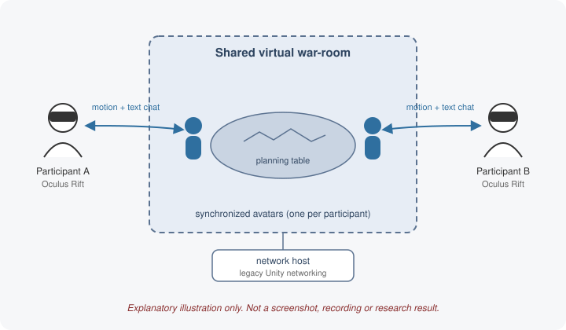

# Multi-user virtual war-room for Oculus Rift

  

<em>Explanatory illustration drawn for this archive. It is not a screenshot, recording or research result from the original project.</em>

This student project explored a shared virtual planning room for Oculus Rift. The recovered Unity C# scripts implement host/join menus, avatar spawning and state synchronization, text chat and scene interactions. The original project description also mentions voice communication, but a voice implementation is not present in this scripts-only snapshot.

Students: Noam Peretz, Mor Furshpan. Supervision: Aaron Wetzler.

## Original code

[`source/scripts/`](source/scripts/) contains 24 unchanged C# files from the June 2014 handoff, excluding the separately withheld `SkyboxMesh.cs`. The companion ZIP held documents, not the rest of a Unity project. Scenes, prefabs, models, media, editor settings and SDK packages are absent.

`Menu`, `NetworkManager`, `LevelManager` and `UserPlayer` hold menu, connection, spawning and player-state logic. `NetworkManager` uses Unity's historical `Network`, `NetworkView`/RPC and `MasterServer` APIs and initializes a server on port 42137. `Chat` sends text messages through RPC; `OnSerializeNetworkView` callbacks transmit player state. These are source observations, not tested multiplayer behavior.

## Setup requirements

There is no runnable Unity project or verified build command. The scripts require the original scene hierarchy, prefabs, input mappings, animation/controllers, tags and missing types. They reference historical Oculus `OVRPlayerController`, `CharacterMotor` and `MovieTexture` APIs; neither a Unity `ProjectVersion` file nor exact Oculus SDK version was recovered.

A restoration would first need the original Unity project/assets and compatible editor/Oculus/controller dependencies. Copying these scripts into a new project is insufficient. `SkyboxMesh.cs`, credited to Nora/stereoarts, was withheld because its redistribution terms were not established.

## Validation and limitations

Recovery checked the script inventory and preserved the handoff bytes, including incomplete/commented code and historical spelling. No editor import, compilation, headset test, network session, voice/audio behavior or gameplay run was recorded. There is no updated implementation or measured latency/performance result.

The November 2026 schematic illustrates the intended room and the motion/text-chat code paths; it does not establish a complete working scene.

## Attribution

Original student credits are preserved. Unity, Oculus and other third-party components retain their own terms; no blanket license is added. Authors can open an issue to contribute updates, correct attribution or request removal.

## Links

- [Project entry on Aaron Wetzler's website](https://twerdster.github.io/#multi-user-virtual-war-room-for-oculus-rift)
